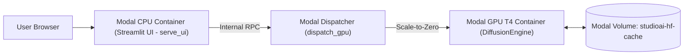

# StudioAI — Image Generation with Stable Diffusion

Proyek ini adalah eksplorasi dan implementasi **image generation** menggunakan model **Stable Diffusion v1.5** (via HuggingFace `diffusers`), dilengkapi aplikasi web interaktif **StudioAI** yang telah di-deploy secara serverless menggunakan **Modal (GPU NVIDIA T4)**.

> **Live Demo (Modal Serverless GPU):**  
> [**Buka StudioAI App**](https://alfdmsr--studioai-stable-diffusion-serve-ui.modal.run)  
> *Catatan: Aplikasi menggunakan arsitektur **scale-to-zero** (GPU hanya menyala saat dibutuhkan atau digunakan). Permintaan pertama setelah idle membutuhkan ±20–40 detik untuk menyalakan GPU, lalu generasi berikutnya hanya ±3–8 detik.*

---

## Ringkasan Proyek

Proyek ini terdiri dari tiga bagian utama:

1. **Pipeline Notebook (`stable_diffusion_pipeline.ipynb`)** — Eksperimen end-to-end mulai dari text-to-image, tuning hyperparameter, base + refiner, inpainting (manual & auto-masking), hingga outpainting/zoom-out.
2. **Colab/Kaggle Deploy Notebook (`studioai_streamlit_deploy.ipynb`)** — Versi notebook mandiri yang men-generate `app.py` & `logic.py` lalu mengeksposnya via Ngrok.
3. **Production Serverless Deployment (`deploy_modal/`)** — Versi aplikasi web **StudioAI** yang dipisahkan ke file Python terstruktur dan di-deploy permanen di **Modal** (UI di CPU ringan + Inference di Serverless GPU T4).

---

## Fitur

### 1. Text-to-Image
- Generate gambar dari `prompt` & `negative_prompt` menggunakan Stable Diffusion v1.5.
- Kontrol penuh atas **Guidance Scale (CFG)**, **Inference Steps**, dan **Seed** (reproducible).
- **Batch inference** — generate hingga 4 gambar sekaligus dari satu prompt (grid 2×2).
- Ganti **scheduler/sampler** secara dinamis tanpa reload model: `Euler A`, `DPM++`, `DDIM`.

### 2. Image-to-Image & Refinement *(Notebook Eksperimen)*
- Teknik **two-stage generation (Base + Refiner)** — tahap awal 80% denoising, disempurnakan 20% sisanya lewat `StableDiffusionImg2ImgPipeline`.

### 3. Inpainting
- Model khusus: `stable-diffusion-v1-5/stable-diffusion-inpainting`.
- **Interactive Canvas Masking (Web App):** Gambar area mask langsung di browser dengan ukuran kuas yang bisa diatur.
- **Upload Gambar Sendiri (Web App):** Mendukung upload gambar PNG/JPG lokal untuk langsung diedit.
- **Auto Masking *(Notebook Eksperimen)*:** Segmentasi objek otomatis menggunakan `facebook/mask2former-swin-base-coco-panoptic`.

### 4. Outpainting & Zoom Out
- **Ekspansi satu arah** (kiri/kanan/atas/bawah) di notebook eksperimen.
- **Zoom Out (Expand)** ke semua arah sekaligus dengan *Gaussian blur background filler* di notebook maupun web app.

### 5. Aplikasi Web StudioAI (Streamlit + Modal)
- Dua tab utama: `✨ GENERATE` dan `🛠️ EDIT` (`Inpainting` & `Outpainting`).
- Tombol **Download PNG** untuk setiap hasil generasi maupun hasil edit.
- Tombol **Flush GPU VRAM** untuk membersihkan cache memori GPU secara manual.
- **Arsitektur hemat biaya (Scale-to-Zero):** UI berjalan di container CPU ringan, sedangkan GPU NVIDIA T4 hanya aktif ketika ada proses generate/edit lalu otomatis mati setelah 2 menit idle.

---

## Arsitektur Deployment (Modal)



- **`serve_ui` (CPU):** Menjalankan antarmuka Streamlit (`deploy_modal/app.py`) dengan biaya sangat rendah; otomatis mati setelah 5 menit tanpa pengunjung.
- **`DiffusionEngine` (GPU NVIDIA T4):** Memuat pipeline `txt2img` & `inpainting` sekali saat container aktif (`@modal.enter`), hanya menyala saat tombol Generate/Edit ditekan, dan otomatis mati setelah 2 menit idle (`max_containers=1`).
- **`studioai-hf-cache` (`modal.Volume`):** Menyimpan bobot model HuggingFace secara persisten agar tidak perlu download ulang di cold start berikutnya.

---

## Struktur Proyek

```text
.
├── deploy_modal/                       # Versi production deployment di Modal (Serverless GPU)
│   ├── modal_app.py                    # Definisi container CPU/GPU, Volume cache, & web server
│   ├── app.py                          # UI Streamlit StudioAI
│   └── logic.py                        # Helper gambar, Diffusers loader, & Modal client bridge
├── stable_diffusion_pipeline.ipynb     # Notebook eksperimen (text2img, refiner, inpainting, outpainting)
├── studioai_streamlit_deploy.ipynb     # Notebook Streamlit + Ngrok (Colab/Kaggle)
├── requirements.txt                    # Dependensi untuk versi notebook
├── .gitignore
└── README.md
```

> Catatan: Versi notebook lama (`stable_diffusion_pipeline.ipynb` dan `studioai_streamlit_deploy.ipynb`) tetap dipertahankan secara utuh dan terpisah dari folder `deploy_modal/`. Pada `studioai_streamlit_deploy.ipynb`, file `app.py` dan `logic.py` di-generate otomatis melalui `%%writefile` saat sel dijalankan.

---

## Tech Stack

- **PyTorch & HuggingFace `diffusers`** — Stable Diffusion pipelines (`Text2Img`, `Img2Img`, `Inpaint`)
- **HuggingFace `transformers` & `accelerate`** — Text encoder, optimasi loading, & segmentasi (Mask2Former)
- **Modal** — Serverless cloud infrastructure (CPU web server, NVIDIA T4 GPU, persistent Volume)
- **Streamlit & `streamlit-drawable-canvas`** — Web UI & canvas interaktif untuk masking
- **Pillow / NumPy** — Pemrosesan gambar & manipulasi mask
- **Pyngrok** — Alternatif tunnel publik untuk versi Colab/Kaggle notebook

---

## Cara Menjalankan & Deploy

### A. Deploy ke Modal *(Direkomendasikan — Online 24/7)*

**Prasyarat:** Akun [Modal](https://modal.com) (paket Starter gratis dengan kredit compute $30/bulan).

1. Buat virtual environment & install `modal` CLI:
   ```bash
   python3 -m venv .venv
   source .venv/bin/activate
   pip install --upgrade pip modal
   ```
2. Autentikasi akun Modal (jika belum pernah login):
   ```bash
   modal token new
   ```
3. Jalankan mode preview/testing (URL sementara + live log):
   ```bash
   modal serve deploy_modal/modal_app.py
   ```
4. Deploy permanen untuk mendapatkan URL publik 24/7:
   ```bash
   modal deploy deploy_modal/modal_app.py
   ```
5. *(Opsional)* Menghentikan deployment di Modal:
   ```bash
   modal app stop studioai-stable-diffusion
   ```

### B. Pipeline Notebook (Eksperimen di Colab / Kaggle)
1. Buka `stable_diffusion_pipeline.ipynb` di Google Colab / Kaggle (aktifkan GPU runtime).
2. Jalankan sel secara berurutan dari atas ke bawah.

### C. Streamlit App via Colab / Kaggle + Ngrok
1. Buka `studioai_streamlit_deploy.ipynb` di Google Colab / Kaggle (aktifkan GPU runtime).
2. Jalankan sel secara berurutan untuk membuat `logic.py` dan `app.py`.
3. Masukkan **Authtoken** dari [ngrok.com](https://ngrok.com) pada variabel `auth_token`.
4. Jalankan sel Streamlit & `ngrok.connect(8501)` untuk mendapatkan public URL.
5. Jalankan `ngrok.kill()` setelah selesai.

---

## Parameter Utama

| Parameter | Deskripsi |
|---|---|
| `prompt` / `negative_prompt` | Deskripsi gambar yang diinginkan / elemen yang dihindari |
| `seed` | Angka acuan agar hasil generasi dapat direproduksi (reproducible) |
| `guidance_scale` (CFG) | Seberapa ketat model mengikuti prompt (rendah = lebih bebas, tinggi = lebih patuh) |
| `num_inference_steps` | Jumlah langkah denoising (lebih tinggi = lebih detail, waktu proses lebih lama) |
| `scheduler` | Algoritma sampling: `Euler A`, `DPM++`, `DDIM` |
| `strength` | *(Inpainting)* Seberapa kuat area mask diubah (`0.1` – `1.0`) |
| `expand_pixels` | *(Outpainting)* Lebar perluasan kanvas per sisi dalam piksel |

---

## Model yang Digunakan

- [`stable-diffusion-v1-5/stable-diffusion-v1-5`](https://huggingface.co/stable-diffusion-v1-5/stable-diffusion-v1-5) — Text-to-image & img2img *(digunakan di `deploy_modal/`; notebook eksperimen mereferensikan `runwayml/stable-diffusion-v1-5`)*
- [`stable-diffusion-v1-5/stable-diffusion-inpainting`](https://huggingface.co/stable-diffusion-v1-5/stable-diffusion-inpainting) — Inpainting & outpainting *(notebook eksperimen mereferensikan `runwayml/stable-diffusion-inpainting`)*
- [`facebook/mask2former-swin-base-coco-panoptic`](https://huggingface.co/facebook/mask2former-swin-base-coco-panoptic) — Segmentasi otomatis untuk auto-masking *(notebook eksperimen)*
